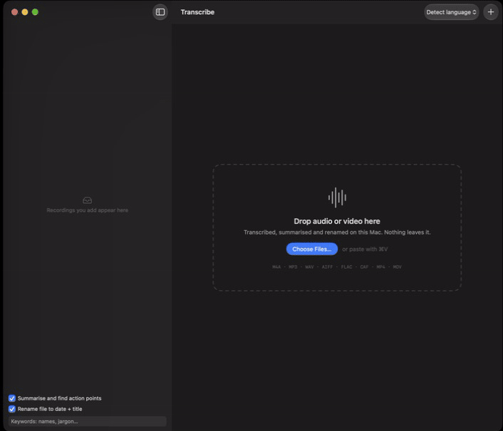

# fk-voice-notes

Mac app that transcribes audio and video on-device with [Whistle](https://cactuscompute.com/blog/whistle), then uses Apple's on-device model to write a title, summary and action points and rename the file to `yyyy-MM-dd Title.ext`.



## Requirements

- Apple Silicon Mac
- Xcode 26 (Xcode 16 builds too, without summaries)
- macOS 14+ to run; summaries and renaming need macOS 26 with Apple Intelligence on

## Setup

```sh
./setup.sh
```

Downloads into `Vendor/` (gitignored), then builds a Release app to `build/Release/fk-voice-notes.app`:

| File | Source |
|---|---|
| `libneedle.a`, `needle.h` | huggingface.co/Cactus-Compute/needle3 (`macos-arm64/`) |
| `whistle.cact` | huggingface.co/Cactus-Compute/whistle |

`./setup.sh --no-build` downloads only.

## Run

Open `fk-voice-notes.xcodeproj` and press ⌘R, or open `build/Release/fk-voice-notes.app`.

Drop audio or video onto the window, the Dock icon, or paste with ⌘V.

## Notes

- Audio is decoded with AVFoundation to 16 kHz mono and split at quiet points into ≤28 s windows (Whistle's limit is 30 s).
- The Needle engine isn't thread-safe; all calls go through one serial queue.
- Renaming and summarising can be turned off in the sidebar.
- Export: Markdown (notes + transcript), plain text, SRT, WebVTT.
